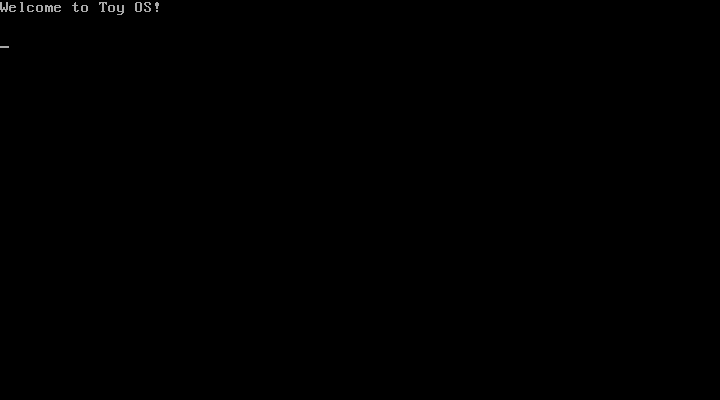

# What is Toy OS?

Toy OS is a perpetual work-in-progress 32-bit x86 protected mode operating system written for learning purposes.

## Building and running Toy OS on Linux

`build.sh` uses a local i686-elf cross-compiler and *grub-mkrescue* if you have them. Otherwise it builds and runs everything inside Docker (or Podman) using the provided *Dockerfile*, so the only requirements are Docker/Podman and [QEMU](https://www.qemu.org) to run it. The first run compiles the cross-compiler into the `toyos-build` image, which takes 15-25 minutes; later runs reuse it.

If you prefer a local toolchain, see the [OSDev wiki](http://wiki.osdev.org/GCC_Cross-Compiler), and install [GNU GRUB](https://www.gnu.org/software/grub/) for *grub-mkrescue*.

From a terminal simply run:

    make run

Other targets (see `make help`):

| Target | Description |
| --- | --- |
| `make` | Build the kernel and `toy_os.iso`. |
| `make unit` | Run the host-side unit tests for the tty driver. |
| `make test` | Run the unit tests, then boot the ISO headless in QEMU and check the serial and VGA output. |
| `make lint` | Run *cppcheck*, *clang-format* (check only) and *shellcheck*. |
| `make format` | Format the C sources with *clang-format*. |
| `make clean` | Remove build outputs. |

`./build.sh` and `./test.sh` can also be called directly.

Kernel messages are also written to the first serial port (COM1), which is how `make test` checks the boot.

## Project layout

    Makefile            Entry point: build, run, test, lint, coverage (see `make help`).
    build.sh            Builds the ISO, inside Docker/Podman if there is no local toolchain.
    test.sh             Boots the ISO headless and checks the serial and VGA output.
    Dockerfile          Cross-compiler (i686-elf) and GRUB build environment.
    tests/              Host-side unit tests.
    toy_os/
      Makefile          Builds the kernel (`toy_os.bin`) and the ISO.
      grub.cfg          GRUB menu entry.
      arch/i386/        x86 specific code: boot.s, tty.c (VGA text), serial.c (COM1).
      include/kernel/   Headers.
      kernel/           Architecture independent code and the linker script.

## How Toy OS boots

1. BIOS loads GRUB from the ISO. GRUB finds the Multiboot header in `boot.s`, loads the kernel
   and jumps to `_start` in 32-bit protected mode.
2. `_start` (`arch/i386/boot.s`) sets up the stack and calls `kernel_main`.
3. `kernel_main` (`kernel/kernel.c`) initializes the serial port and the terminal, and prints
   its messages to the screen (VGA text buffer at `0xB8000`) and to COM1.
4. If `kernel_main` returns, the CPU is halted.

## Testing

`make test` runs two kinds of tests:

- **Unit tests** (`make unit`): `tty.c` is compiled with the host compiler against a fake VGA
  buffer, with guard cells to catch out-of-bounds writes. `make coverage` reports their coverage
  (it needs [gcovr](https://gcovr.com)); the results are uploaded to Codecov by CI. The boot
  code, the serial driver and `kernel_main` cannot run on the host, so they are not measured.
- **Smoke test** (`./test.sh`): boots the ISO headless in QEMU and checks the serial output and
  the VGA text buffer.

To debug with GDB run `make debug` and, in another terminal,
`gdb toy_os/toy_os.bin -ex 'target remote :1234'`. `make hooks` installs a git pre-commit hook
that runs `make lint`.
